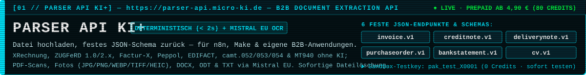
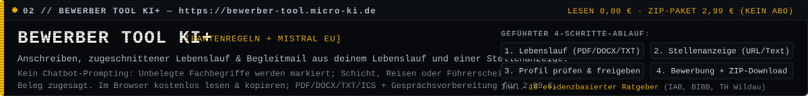
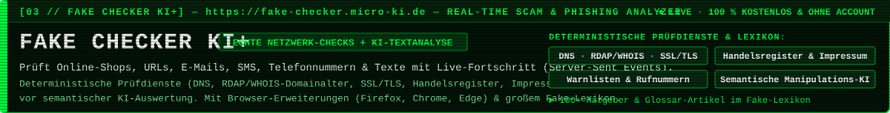
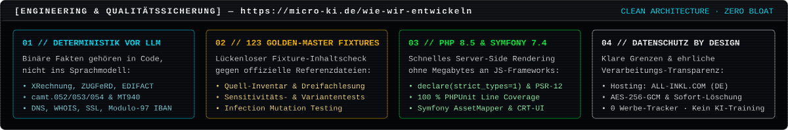

<div align="center">

<a href="https://micro-ki.de">
  
</a>

<p align="center">
  <a href="https://micro-ki.de"><strong>Plattform-Hub</strong></a>
  &nbsp;&nbsp;·&nbsp;&nbsp;
  <a href="https://parser-api.micro-ki.de"><strong>Parser API KI+</strong></a>
  &nbsp;&nbsp;·&nbsp;&nbsp;
  <a href="https://bewerber-tool.micro-ki.de"><strong>Bewerber Tool KI+</strong></a>
  &nbsp;&nbsp;·&nbsp;&nbsp;
  <a href="https://fake-checker.micro-ki.de"><strong>Fake Checker KI+</strong></a>
  &nbsp;&nbsp;·&nbsp;&nbsp;
  <a href="https://github.com/Micro-KI/n8n-nodes-parser-api-ki"><strong>n8n Node</strong></a>
  &nbsp;&nbsp;·&nbsp;&nbsp;
  <a href="https://github.com/Micro-KI/make-app-parser-api-ki"><strong>Make App</strong></a>
  &nbsp;&nbsp;·&nbsp;&nbsp;
  <a href="https://micro-ki.de/wie-wir-entwickeln"><strong>Architektur &amp; Tests</strong></a>
</p>

</div>

---

## Was ist Micro KI+?

> **KI mit klarem Auftrag statt KI, die alles verspricht.**  
> Bei **[Micro KI+](https://micro-ki.de)** steht **Micro** für den bewusst eng gesteckten Rahmen: eine klar abgegrenzte Spezialaufgabe, ein fester Ablauf und Systemgrenzen, die man auf einen Blick versteht. **KI+** steht für unsere Architektur: **deterministische Prüfungen vor generativer KI** — was sich in Programmcode exakt berechnen, parsen oder gegen Register und Standards validieren lässt, wird niemals einem Sprachmodell zum Schätzen überlassen.

| Live-Werkzeug | Fokus & Spezialaufgabe | Deterministische Engine *(0 KI)* | KI-Inferenz | Preismodell *(Kein Abo)* |
| :--- | :--- | :--- | :--- | :--- |
| **[Parser API KI+](https://parser-api.micro-ki.de)**<br/>*([Überblick](https://micro-ki.de/parser-api))* | B2B-Dokumenten-Parser REST-API für **[n8n](https://parser-api.micro-ki.de/n8n)**, **[Make](https://parser-api.micro-ki.de/make)** & eigene Workflows (`6` feste JSON-Schemas) | **[XRechnung & ZUGFeRD](https://parser-api.micro-ki.de/xrechnung-zugferd)**, Factur-X, Peppol, UBL, EDIFACT, `camt.052/053/054`, `MT940/942` (`< 2 s`) + Modulo-97-IBAN- & Summenprüfung | **Mistral EU** (`api.eu.mistral.ai`) für PDF-OCR, Fotos, DOCX, ODT & TXT | **Prepaid-Credits** ab **[4,90 € für 80 Credits](https://parser-api.micro-ki.de/starten)** *(Sandbox-Key kostenlos)* |
| **[Bewerber Tool KI+](https://bewerber-tool.micro-ki.de)**<br/>*([Überblick](https://micro-ki.de/bewerber-tool))* | Maßgeschneiderte Bewerbung (Anschreiben, Lebenslauf, Begleitmail) in 4 Schritten aus Lebenslauf + Stellenanzeige | Feste Fakten- & Belegregeln: unbelegte Anforderungen werden markiert; Schicht, Reisen oder Führerschein nie ohne Beleg zugesagt | **Mistral EU** (`api.eu.mistral.ai`) ohne Modelltraining mit Nutzerdaten | **Lesen & Kopieren 0,00 €** · Komplettes ZIP-Paket (PDF, DOCX, TXT, ICS) **2,99 € einmalig** |
| **[Fake Checker KI+](https://fake-checker.micro-ki.de)**<br/>*([Überblick](https://micro-ki.de/fake-checker))* | Echtzeit-Analyse (SSE) von Fake-Shops, Phishing-Mails, Smishing-SMS, Telefonnummern & verdächtigen Texten | DNS-Records, RDAP/WHOIS-Domainalter, SSL/TLS-Zertifikate, Handelsregister, Impressums-Check & Warnlisten | **OpenRouter & Google Gemini** (USA) für semantische Manipulationsmuster | **100 % kostenlos** & ohne Account *(inkl. [Browser-Add-ons](https://fake-checker.micro-ki.de/browser-erweiterung))* |

---

## 01 // Parser API KI+ — Dokumenten-Extraction mit festem JSON-Vertrag

<a href="https://parser-api.micro-ki.de">
  
</a>

Die **[Parser API KI+](https://parser-api.micro-ki.de)** nimmt Geschäftsdokumente als `multipart/form-data` entgegen und liefert ein **garantiert stabiles JSON-Schema** zurück. Strukturierte E-Rechnungen, EDI-Nachrichten und Bankformate werden in unter 2 Sekunden rein deterministisch ohne KI verarbeitet; PDFs, Scans, Fotos (`JPG`, `PNG`, `WEBP`, `TIFF`, `HEIC`) und Office-Dateien (`DOCX`, `ODT`, `TXT`) werden über **Mistral in der EU** ausgelesen, kaufmännisch nachgeprüft (Summen, Salden, Modulo-97-IBAN) und unmittelbar nach der Antwort vom Server gelöscht.

### 🚀 Sofort im Terminal testen (Öffentlicher Sandbox-Key `pak_test_X0001` · `0` Credits)

Mit dem öffentlichen Test-Key `pak_test_X0001` lässt sich jeder Endpunkt sofort ohne Registrierung ausprobieren (liefert deterministisch die offizielle Beispielantwort der [API-Dokumentation](https://parser-api.micro-ki.de/doku)):

```bash
# 1. Kontostand & Verbindung prüfen (0 Credits)
curl -s https://parser-api.micro-ki.de/api/v1/account \
  -H "Authorization: Bearer pak_test_X0001"

# 2. Rechnung an POST /api/v1/invoice senden -> festes Schema invoice.v1
curl -s -X POST https://parser-api.micro-ki.de/api/v1/invoice \
  -H "Authorization: Bearer pak_test_X0001" \
  -F "file=@invoice.pdf"
```

### 📋 Die 6 Dokumenttypen, Endpunkte & Spezifikationen

Jeder Dokumenttyp besitzt einen eigenen Endpunkt, damit z. B. eine eingegangene **[Gutschrift](https://parser-api.micro-ki.de/gutschrift)** am Rechnungs-Endpunkt niemals versehentlich als zahlbare **[Rechnung](https://parser-api.micro-ki.de/rechnung)** durchläuft (bei falschem Endpunkt meldet die API `error.detected_type` zurück):

| Dokumenttyp & Landingpage | HTTP-Endpunkt | JSON-Schema | Unterstützte Formate & Besonderheiten | Fachspezifikation (DE / EN) |
| :--- | :--- | :---: | :--- | :--- |
| **[Rechnungen auslesen](https://parser-api.micro-ki.de/rechnung)**<br/>↳ *[XRechnung & ZUGFeRD auslesen](https://parser-api.micro-ki.de/xrechnung-zugferd)* | `POST /api/v1/invoice` | `invoice.v1` | PDF, Scan, Foto, DOCX, **[XRechnung](https://parser-api.micro-ki.de/xrechnung-zugferd)** (CII/UBL), **[ZUGFeRD 1.0/2.x](https://parser-api.micro-ki.de/xrechnung-zugferd)**, Factur-X, Peppol BIS, EDIFACT `INVOIC`. Inkl. `X-Parser-Lines: ocr` für hybride `MINIMUM`/`BASIC WL`-PDFs. | [DE (.md)](https://parser-api.micro-ki.de/doku/rechnung.de.md) · [DE (.pdf)](https://parser-api.micro-ki.de/doku/rechnung.de.pdf)<br/>[EN (.md)](https://parser-api.micro-ki.de/doku/rechnung.en.md) · [EN (.pdf)](https://parser-api.micro-ki.de/doku/rechnung.en.pdf) |
| **[Gutschriften auslesen](https://parser-api.micro-ki.de/gutschrift)** | `POST /api/v1/credit-note` | `creditnote.v1` | PDF, Scan, Foto, XRechnung/ZUGFeRD/UBL-CreditNote (`TypeCode 381`). Mit Referenz auf Ursprungsrechnung & Gutschriftsgrund. | [DE (.md)](https://parser-api.micro-ki.de/doku/gutschrift.de.md) · [DE (.pdf)](https://parser-api.micro-ki.de/doku/gutschrift.de.pdf)<br/>[EN (.md)](https://parser-api.micro-ki.de/doku/gutschrift.en.md) · [EN (.pdf)](https://parser-api.micro-ki.de/doku/gutschrift.en.pdf) |
| **[Lieferscheine auslesen](https://parser-api.micro-ki.de/lieferschein)** | `POST /api/v1/delivery-note` | `deliverynote.v1` | PDF, Scan, Foto, DOCX, UBL DespatchAdvice, EDIFACT `DESADV`. Positionen, Chargen, Seriennummern, Gewicht & Lieferadresse. | [DE (.md)](https://parser-api.micro-ki.de/doku/lieferschein.de.md) · [DE (.pdf)](https://parser-api.micro-ki.de/doku/lieferschein.de.pdf)<br/>[EN (.md)](https://parser-api.micro-ki.de/doku/lieferschein.en.md) · [EN (.pdf)](https://parser-api.micro-ki.de/doku/lieferschein.en.pdf) |
| **[Bestellungen auslesen](https://parser-api.micro-ki.de/bestellung)** | `POST /api/v1/purchase-order` | `purchaseorder.v1` | PDF, Scan, Foto, DOCX, ODT, TXT, UBL Order, EDIFACT `ORDERS`. Bestellnummer, Liefertermin, Artikelpositionen & Preise. | [DE (.md)](https://parser-api.micro-ki.de/doku/bestellung.de.md) · [DE (.pdf)](https://parser-api.micro-ki.de/doku/bestellung.de.pdf)<br/>[EN (.md)](https://parser-api.micro-ki.de/doku/bestellung.en.md) · [EN (.pdf)](https://parser-api.micro-ki.de/doku/bestellung.en.pdf) |
| **[Kontoauszüge auslesen](https://parser-api.micro-ki.de/kontoauszug)** | `POST /api/v1/bank-statement` | `bankstatement.v1` | ISO 20022 `camt.052`, `camt.053`, `camt.054`, SWIFT `MT940` / `MT942`, CSV, XLSX sowie PDF-Kontoauszüge mit Salden- & Umsatzprüfung. | [DE (.md)](https://parser-api.micro-ki.de/doku/kontoauszug.de.md) · [DE (.pdf)](https://parser-api.micro-ki.de/doku/kontoauszug.de.pdf)<br/>[EN (.md)](https://parser-api.micro-ki.de/doku/kontoauszug.en.md) · [EN (.pdf)](https://parser-api.micro-ki.de/doku/kontoauszug.en.pdf) |
| **[Lebensläufe auslesen](https://parser-api.micro-ki.de/lebenslauf)** | `POST /api/v1/cv` | `cv.v1` | PDF, DOCX, ODT, TXT & Scans in strukturierte Bewerberprofile (Berufserfahrung, Ausbildung, Skills, Sprachen, Zertifikate). | [DE (.md)](https://parser-api.micro-ki.de/doku/lebenslauf.de.md) · [DE (.pdf)](https://parser-api.micro-ki.de/doku/lebenslauf.de.pdf)<br/>[EN (.md)](https://parser-api.micro-ki.de/doku/lebenslauf.en.md) · [EN (.pdf)](https://parser-api.micro-ki.de/doku/lebenslauf.en.pdf) |

### 🔌 Offizielle Open-Source-Integrationen für n8n & Make

* **n8n Community Node (`n8n-nodes-parser-api-ki`)**:
  * **GitHub-Repository:** **[`Micro-KI/n8n-nodes-parser-api-ki`](https://github.com/Micro-KI/n8n-nodes-parser-api-ki)** (MIT-Lizenz, TypeScript, für n8n 2.x)
  * **Installation in n8n:** `Settings → Community nodes → Install → n8n-nodes-parser-api-ki`
  * **Landingpage & Workflow-Vorlagen:** **[n8n-Integration der Parser API KI+](https://parser-api.micro-ki.de/n8n)** · [Handbuch DE (.md)](https://parser-api.micro-ki.de/doku/n8n.de.md) · [DE (.pdf)](https://parser-api.micro-ki.de/doku/n8n.de.pdf) · [EN (.md)](https://parser-api.micro-ki.de/doku/n8n.en.md) · [EN (.pdf)](https://parser-api.micro-ki.de/doku/n8n.en.pdf)
* **Make Custom App (`make-app-parser-api-ki`)**:
  * **GitHub-Repository:** **[`Micro-KI/make-app-parser-api-ki`](https://github.com/Micro-KI/make-app-parser-api-ki)** (MIT-Lizenz, 100 % statisches Output-Interface je Dokumenttyp + synthetische Testdateien in `samples/`)
  * **Direkt-Installation in Make:** **[Parser API KI+ in Make installieren (Invite-Link)](https://www.make.com/en/hq/app-invitation/14daf32a9d18de978f6d1a4d2a23c015)**
  * **Landingpage & Blueprints:** **[Make-Integration der Parser API KI+](https://parser-api.micro-ki.de/make)** · [Handbuch DE (.md)](https://parser-api.micro-ki.de/doku/make.de.md) · [DE (.pdf)](https://parser-api.micro-ki.de/doku/make.de.pdf) · [EN (.md)](https://parser-api.micro-ki.de/doku/make.en.md) · [EN (.pdf)](https://parser-api.micro-ki.de/doku/make.en.pdf)

🔗 **Weitere Links zur Parser API KI+:** **[Startseite](https://parser-api.micro-ki.de)** · **[Vollständige API-Dokumentation (`/doku`)](https://parser-api.micro-ki.de/doku)** · **[So funktioniert's (`/so-funktionierts`)](https://parser-api.micro-ki.de/so-funktionierts)** · **[Startpaket & Prepaid-Credits kaufen (`/starten`)](https://parser-api.micro-ki.de/starten)** · **[Hilfe & FAQ (`/hilfe`)](https://parser-api.micro-ki.de/hilfe)** · **[AV-Vertrag nach Art. 28 DSGVO (`/av-vertrag`)](https://parser-api.micro-ki.de/av-vertrag)** · **[Datenschutz (`/datenschutz`)](https://parser-api.micro-ki.de/datenschutz)** · **[AGB (`/agb`)](https://parser-api.micro-ki.de/agb)** · **[Produktübersicht auf micro-ki.de](https://micro-ki.de/parser-api)** · **[`llms.txt`](https://parser-api.micro-ki.de/llms.txt)**

---

## 02 // Bewerber Tool KI+ — Maßgeschneiderte Bewerbung mit Faktenprüfung

<a href="https://bewerber-tool.micro-ki.de">
  
</a>

Das **[Bewerber Tool KI+](https://bewerber-tool.micro-ki.de)** erstellt aus einem vorhandenen Lebenslauf (`PDF`, `DOCX`, `ODT`, `TXT`) und einer konkreten Stellenanzeige (URL oder Text) in vier geführten Schritten ein komplettes Bewerbungspaket: **individuelles Anschreiben**, **auf die Stelle zugeschnittener Lebenslauf** und **passende Begleitmail**.

* **Kein blindes KI-Fabulieren:** Vor dem Schreiben prüft und korrigiert der Nutzer das ausgelesene Profil. Harte Regeln neben **Mistral EU** markieren Fachbegriffe aus der Anzeige, die nicht im Lebenslauf belegt sind, zum Gegenlesen und verhindern, dass Bedingungen wie Schichtarbeit, Reisebereitschaft oder Führerschein ohne Nachweis zugesagt werden.
* **Fair & ohne Abo:** Das Lesen und Kopieren aller Texte im Browser ist **dauerhaft kostenlos (`0,00 €`)**. Das fertige Download-Paket (`PDF`, `DOCX`, `TXT`, `.ics`-Kalendereintrag im passwortgeschützten ZIP inklusive Nachfass-Mails und Gesprächsvorbereitung) kostet **einmalig 2,99 €**.

🔗 **Direktlinks:** **[Web-App starten (`bewerber-tool.micro-ki.de`)](https://bewerber-tool.micro-ki.de)** · **[Bewerbungs-Assistent (`/bewerbung`)](https://bewerber-tool.micro-ki.de/bewerbung)** · **[So funktioniert's (`/so-funktionierts`)](https://bewerber-tool.micro-ki.de/so-funktionierts)** · **[Hilfe & FAQ (`/hilfe`)](https://bewerber-tool.micro-ki.de/hilfe)** · **[Datenschutz (`/datenschutz`)](https://bewerber-tool.micro-ki.de/datenschutz)** · **[Produktseite auf micro-ki.de](https://micro-ki.de/bewerber-tool)** · **[`llms.txt`](https://bewerber-tool.micro-ki.de/llms.txt)** · **[`llms-full.txt`](https://bewerber-tool.micro-ki.de/llms-full.txt)**

### 📚 Alle 16 evidenzbasierten Bewerbungs-Ratgeber (mit Studien von IAB, BIBB, TH Wildau & StepStone)

| Phase 1 & 2: Grundlagen, KI-Einsatz & Stellenanzeige | Phase 3 & 4: Anschreiben, Lebenslauf, Versand & Nachfassen |
| :--- | :--- |
| 📘 **[Bewerbung schreiben (Ratgeber-Hub)](https://bewerber-tool.micro-ki.de/bewerbung-schreiben)** — Was in eine Bewerbung gehört, Reihenfolge & Fahrplan | ✍️ **[Anschreiben Einleitung formulieren](https://bewerber-tool.micro-ki.de/anschreiben-einleitung)** — Einleitungssatz in 3 Schritten + Austauschtest |
| 🤖 **[Mit KI bewerben (ChatGPT & Co.)](https://bewerber-tool.micro-ki.de/mit-ki-bewerben)** — Rechtslage, Personaler-Umfragen, 5 Prompts & Datenschutz | 👤 **[Anschreiben ohne Ansprechpartner](https://bewerber-tool.micro-ki.de/anschreiben-ohne-ansprechpartner)** — Recherche, Telefonfragen & passende Anrede |
| 🔍 **[Anschreiben klingt nach KI](https://bewerber-tool.micro-ki.de/anschreiben-klingt-nach-ki)** — Experiment TH Wildau, typische KI-Floskeln & 3 Prüfungen | 🔀 **[Anschreiben für den Quereinstieg](https://bewerber-tool.micro-ki.de/quereinstieg-anschreiben)** — Transfertabelle, BIBB/IAB-Daten & Praxisbeispiele |
| 🧪 **[Anschreiben online erstellen (Echter Durchlauf)](https://bewerber-tool.micro-ki.de/anschreiben-erstellen)** — Ungekürzter Durchlauf, Satz für Satz auf Belege geprüft | 🇬🇧 **[Anschreiben auf Englisch (Cover Letter)](https://bewerber-tool.micro-ki.de/anschreiben-auf-englisch)** — UK/US-Konventionen, BIBB-Berufstitel & Muster |
| 🎯 **[Anschreiben aus Stellenanzeige ableiten](https://bewerber-tool.micro-ki.de/anschreiben-aus-stellenanzeige)** — Muss- vs. Kann-Kriterien erkennen & mit Situationen belegen | 📄 **[Lebenslauf an Stellenanzeige anpassen](https://bewerber-tool.micro-ki.de/lebenslauf-anpassen)** — Begriffe der Anzeige mit eigenen Stationen belegen |
| ⚖️ **[Nicht alle Anforderungen erfüllt](https://bewerber-tool.micro-ki.de/nicht-alle-anforderungen)** — IAB-Betriebspanel, 6 Arten von Lücken & ehrliche Formulierungen | 🗂️ **[KI-Lebenslauf-Generator im Test](https://bewerber-tool.micro-ki.de/ki-lebenslauf-generator)** — 3 Bauarten von Generatoren & Prüfliste gegen Halluzinationen |
| 📝 **[Bewerbung ohne Anschreiben](https://bewerber-tool.micro-ki.de/bewerbung-ohne-anschreiben)** — Was „optional" heißt & was in 1.000-Zeichen-Motivationsfelder gehört | 📧 **[Bewerbung per E-Mail versenden](https://bewerber-tool.micro-ki.de/bewerbung-per-e-mail)** — Betreff, Dateinamen, PDF-Größe & 2 Muster-Mails |
| 💾 **[Stellenanzeige nicht mehr online](https://bewerber-tool.micro-ki.de/stellenanzeige-speichern)** — Verschwundene Ausschreibungen wiederfinden & vorab sichern | ⏳ **[Keine Rückmeldung auf die Bewerbung](https://bewerber-tool.micro-ki.de/keine-rueckmeldung-bewerbung)** — Wartefristen, 3 Nachfass-Muster & Telefon-Spickzettel |

---

## 03 // Fake Checker KI+ — Echtzeit-Schutz vor Fake-Shops, Phishing & Betrug

<a href="https://fake-checker.micro-ki.de">
  
</a>

Der **[Fake Checker KI+](https://fake-checker.micro-ki.de)** prüft verdächtige Online-Shops, URLs, E-Mails, SMS, Telefonnummern und Texte in Echtzeit per Server-Sent Events (SSE). Bevor ein Sprachmodell psychologische Druckmuster oder Textinhalte bewertet, führt unsere Engine harte technische Prüfungen durch: **DNS-Auflösung, RDAP/WHOIS-Domainalter, SSL/TLS-Zertifikate, Handelsregister-Abgleich, Impressums-Erreichbarkeit und Warnlisten**.

* **100 % kostenlos & ohne Registrierung:** Direkt im Browser unter **[fake-checker.micro-ki.de](https://fake-checker.micro-ki.de)** nutzbar.
* **Ein-Klick-Prüfung im Browser:** Offizielle **[Browser-Erweiterung für Mozilla Firefox, Google Chrome & Microsoft Edge](https://fake-checker.micro-ki.de/browser-erweiterung)**.
* **Aufklärung & Notfallhilfe:** Umfassendes **[Fake-Lexikon (`/fake-lexikon`)](https://fake-checker.micro-ki.de/fake-lexikon)** und **[Betrugs-Glossar (`/fake-lexikon/glossar`)](https://fake-checker.micro-ki.de/fake-lexikon/glossar)** mit über 100 Artikeln in verständlicher Sprache.

🔗 **Direktlinks:** **[Fake Checker Web-App](https://fake-checker.micro-ki.de)** · **[Browser-Erweiterung (`/browser-erweiterung`)](https://fake-checker.micro-ki.de/browser-erweiterung)** · **[Fake-Lexikon (`/fake-lexikon`)](https://fake-checker.micro-ki.de/fake-lexikon)** · **[Glossar (`/fake-lexikon/glossar`)](https://fake-checker.micro-ki.de/fake-lexikon/glossar)** · **[Hilfe & Notfall-Leitfaden (`/hilfe`)](https://fake-checker.micro-ki.de/hilfe)** · **[Datenschutz (`/datenschutz`)](https://fake-checker.micro-ki.de/datenschutz)** · **[Produktseite auf micro-ki.de](https://micro-ki.de/fake-checker)** · **[`llms.txt`](https://fake-checker.micro-ki.de/llms.txt)** · **[`llms-full.txt`](https://fake-checker.micro-ki.de/llms-full.txt)**

### 🛡️ Ausgewählte Themen-Ratgeber & Glossar-Artikel im Fake-Lexikon

| Häufige Betrugsmaschen (Themen-Ratgeber) | Wichtige Begriffe & Schutzmechanismen (Glossar) |
| :--- | :--- |
| 🛒 **[Fake-Shop erkennen & melden](https://fake-checker.micro-ki.de/fake-lexikon/themen/fakeshop)** — Warnzeichen, Vorkasse-Fallen & Soforthilfe nach Bestellung | ⛓️ **[Kettenbrief erkennen](https://fake-checker.micro-ki.de/fake-lexikon/glossar/kettenbrief)** — WhatsApp- & Messenger-Kettenbriefe einordnen |
| 🛡️ **[Schutz vor Online-Betrug](https://fake-checker.micro-ki.de/fake-lexikon/themen/online-betrug-schutz)** — Grundregeln für sicheres Bezahlen, Passwörter & 2FA | 🎮 **[Google-Play- & Guthabenkarten-Betrug](https://fake-checker.micro-ki.de/fake-lexikon/glossar/google-play-betrug)** — Warum Betrüger Gutscheincodes verlangen |
| 🏦 **[Onlinebanking-Betrug & Phishing](https://fake-checker.micro-ki.de/fake-lexikon/themen/onlinebanking-betrug)** — PushTAN-Fallen, gefälschte Bank-Logins & Sperrnotruf | 🪙 **[Krypto-Betrug (Crypto Scams)](https://fake-checker.micro-ki.de/fake-lexikon/glossar/krypto-betrug)** — Falsche Trading-Plattformen & Wallet-Drainer |
| 👔 **[CEO-Fraud (Chef-Masche)](https://fake-checker.micro-ki.de/fake-lexikon/themen/ceo-fraud)** — Gefälschte E-Mails der Geschäftsführung in Unternehmen erkennen | ✉️ **[E-Mail-Spoofing](https://fake-checker.micro-ki.de/fake-lexikon/glossar/e-mail-spoofing)** — Wie Absenderadressen gefälscht werden (SPF, DKIM, DMARC) |
| 🎁 **[Gewinnspiel-Betrug](https://fake-checker.micro-ki.de/fake-lexikon/themen/gewinnspiel-betrug)** — Angebliche Gewinne per Telefon, SMS, E-Mail & Social Media | 🎣 **[Phishing](https://fake-checker.micro-ki.de/fake-lexikon/glossar/phishing)** · **[Quishing (QR-Code-Phishing)](https://fake-checker.micro-ki.de/fake-lexikon/glossar/quishing)** · **[eTA-/Visum-Phishing](https://fake-checker.micro-ki.de/fake-lexikon/glossar/eta-phishing)** |
| 🎧 **[Fake-Kundenservice & Tech-Support-Scam](https://fake-checker.micro-ki.de/fake-lexikon/themen/fake-kundenservice)** — Gefälschte Hotlines & Fernwartungs-Abzocke | 🎟️ **[Geschenkkarten-Betrug](https://fake-checker.micro-ki.de/fake-lexikon/glossar/geschenkkarten-betrug)** · **[Käuferschutz richtig nutzen](https://fake-checker.micro-ki.de/fake-lexikon/glossar/kaeuferschutz)** |
| 🏛️ **[Behörden-Phishing (ELSTER, Zoll, Polizei)](https://fake-checker.micro-ki.de/fake-lexikon/themen/behoerden-phishing)** & **[Falsche Polizisten](https://fake-checker.micro-ki.de/fake-lexikon/themen/falsche-polizisten)** | 💳 **[Vorkasse-Betrug](https://fake-checker.micro-ki.de/fake-lexikon/glossar/vorkasse-betrug)** · **[Dreiecksbetrug](https://fake-checker.micro-ki.de/fake-lexikon/glossar/dreiecksbetrug)** · **[Vorschussbetrug (419-Scam)](https://fake-checker.micro-ki.de/fake-lexikon/glossar/vorschussbetrug)** |
| 📈 **[Anlagebetrug](https://fake-checker.micro-ki.de/fake-lexikon/themen/anlagebetrug)** · **[Jobbetrug](https://fake-checker.micro-ki.de/fake-lexikon/themen/jobbetrug)** · **[Deepfakes erkennen](https://fake-checker.micro-ki.de/fake-lexikon/themen/deepfakes)** | 🏦 **[Kreditvermittlungsbetrug](https://fake-checker.micro-ki.de/fake-lexikon/glossar/kreditvermittlungsbetrug)** · **[Zwei-Faktor-Authentifizierung (2FA)](https://fake-checker.micro-ki.de/fake-lexikon/glossar/zwei-faktor-authentifizierung)** |

---

## ⚙️ Engineering, Architektur & KI-Workflows

<a href="https://micro-ki.de/wie-wir-entwickeln">
  
</a>

Unsere Werkzeuge folgen strengen Software-Engineering-Standards statt schnellen Prototyp-Hacks. Auf unserem Plattform-Hub **[micro-ki.de](https://micro-ki.de)** dokumentieren wir unsere Architektur und Entwicklungsprozesse offen:

* 🛠️ **[Wie wir Software entwickeln (`micro-ki.de/wie-wir-entwickeln`)](https://micro-ki.de/wie-wir-entwickeln)**  
  Einblick in unsere Architektur mit **PHP 8.5** (`declare(strict_types=1)`), **Symfony 7.4**, Server-Side Rendering via **Symfony AssetMapper** (ohne Webpack/Vite-Bloat), **100 % PHPUnit Line Coverage**, **PHPStan**, **Infection Mutation Testing** sowie unseren **123 offiziellen Golden-Master-Referenzdateien** mit Quell-Inventar, Dreifachlesung, Sensitivitäts- und Variantentests.
* 🖥️ **[Alternative zu Claude Code und Cursor: Unser OpenCode v2 Workflow (`micro-ki.de/alternative-zu-claude-code-und-cursor`)](https://micro-ki.de/alternative-zu-claude-code-und-cursor)**  
  Praxisbericht, Modell-Benchmarks und Umstiegsleitfaden für Softwareentwickler zum Einsatz von **OpenCode v2** (Desktop-App, CLI, VS Code) mit strikter Trennung von Read-Only-Architekturplanung und Code-Ausführung bei Zero Data Retention.

### 🤖 Maschinenlesbarer LLM-Kontext (`llms.txt` / `llms-full.txt`) & Sitemaps

Alle vier Micro-KI+-Domains liefern dynamisch generierte Markdown-Kontextdateien nach dem `llms.txt`-Standard für KI-Agenten, Suchmaschinen und RAG-Systeme aus:

| Plattform / Projekt | Live-URL | `llms.txt` (Kompakt) | `llms-full.txt` (Volltext) | XML-Sitemap |
| :--- | :--- | :--- | :--- | :--- |
| **Micro KI+ Dach-Hub** | [https://micro-ki.de](https://micro-ki.de) | [`micro-ki.de/llms.txt`](https://micro-ki.de/llms.txt) | [`micro-ki.de/llms-full.txt`](https://micro-ki.de/llms-full.txt) | [`sitemap.xml`](https://micro-ki.de/sitemap.xml) |
| **Parser API KI+** | [https://parser-api.micro-ki.de](https://parser-api.micro-ki.de) | [`parser-api.micro-ki.de/llms.txt`](https://parser-api.micro-ki.de/llms.txt) | [`parser-api.micro-ki.de/doku`](https://parser-api.micro-ki.de/doku) *(DE/EN `.md` & `.pdf`)* | [`sitemap.xml`](https://parser-api.micro-ki.de/sitemap.xml) |
| **Bewerber Tool KI+** | [https://bewerber-tool.micro-ki.de](https://bewerber-tool.micro-ki.de) | [`bewerber-tool.micro-ki.de/llms.txt`](https://bewerber-tool.micro-ki.de/llms.txt) | [`bewerber-tool.micro-ki.de/llms-full.txt`](https://bewerber-tool.micro-ki.de/llms-full.txt) | [`sitemap.xml`](https://bewerber-tool.micro-ki.de/sitemap.xml) |
| **Fake Checker KI+** | [https://fake-checker.micro-ki.de](https://fake-checker.micro-ki.de) | [`fake-checker.micro-ki.de/llms.txt`](https://fake-checker.micro-ki.de/llms.txt) | [`fake-checker.micro-ki.de/llms-full.txt`](https://fake-checker.micro-ki.de/llms-full.txt) | [`sitemap.xml`](https://fake-checker.micro-ki.de/sitemap.xml) |

---

## 👨‍💻 Über den Gründer & Kontakt

**Micro KI+** wird entwickelt und betrieben von **[Jörg Thode](https://micro-ki.de/about)** — Fachinformatiker für Anwendungsentwicklung, Scrum.org-zertifizierter Product Owner (PSPO I) und Fullstack-Entwickler aus Mainz.

* 🌍 **Plattform-Hub:** **[https://micro-ki.de](https://micro-ki.de)** · **[Über Jörg Thode (`/about`)](https://micro-ki.de/about)**
* 💼 **LinkedIn:** **[Micro KI+ Company Page](https://www.linkedin.com/company/micro-ki/)** · **[Jörg Thode auf LinkedIn](https://www.linkedin.com/in/joerg-thode/)**
* 🐙 **GitHub:** **[github.com/Micro-KI](https://github.com/Micro-KI)** · **[github.com/j-thode](https://github.com/j-thode)**
* ✉️ **Kontakt & Rechtliches:** **[j.thode@micro-ki.de](mailto:j.thode@micro-ki.de)** · **[Impressum (`micro-ki.de/impressum`)](https://micro-ki.de/impressum)** · **[Datenschutzerklärung (`micro-ki.de/datenschutz`)](https://micro-ki.de/datenschutz)**
